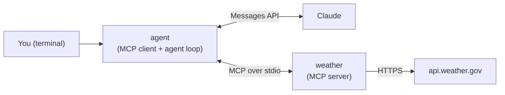

# Weather Agent in Go: Claude + the Model Context Protocol

A command-line weather assistant written in Go. You ask a question in plain English,
Claude decides which tools to call, and a Go MCP server fetches live data from the
US National Weather Service.

I built this to learn the [Model Context Protocol](https://modelcontextprotocol.io) (MCP)
in Go, using the official [Go SDK](https://github.com/modelcontextprotocol/go-sdk) and the
[Anthropic Go SDK](https://github.com/anthropics/anthropic-sdk-go). It covers the full
loop: an MCP server, an MCP client, and an agent that connects Claude to the server's tools.

```text
You: How many weather alerts are active in TX, and what is the high tomorrow in Austin?
Claude: I'll fetch both pieces of information simultaneously!
tool: get_alerts({"state":"TX"})
tool: get_forecast({"latitude":30.2672,"longitude":-97.7431})
Claude: - TX Weather Alerts: There are currently 0 active alerts in Texas.
        - Austin High Tomorrow (Tuesday): The high will be 83°F and sunny.
```

## How it works



1. On startup, the agent launches the `weather` server as a child process and connects
   to it over stdio.
2. It asks the server for its tools and converts their JSON schemas into Anthropic tool
   definitions, so any tool added to the server becomes available to Claude automatically.
3. For each question, the agent sends the conversation to Claude. When Claude replies with
   `tool_use` blocks, the agent runs each call through the MCP session and sends all the
   results back in a single message.
4. The loop repeats until Claude stops asking for tools and answers.

Tool failures are returned to Claude as `is_error` results rather than crashing the
agent, so Claude can retry or explain what went wrong.

## Tools

| Tool | Arguments | Returns |
|---|---|---|
| `get_forecast` | `latitude`, `longitude` | The next 5 forecast periods for a US location |
| `get_alerts` | `state` (two-letter US code, e.g. `CA`) | Active weather alerts for that state |

You don't need to know coordinates: the agent's system prompt tells Claude to convert
city names into latitude and longitude.

## Getting started

Requirements: Go 1.25+ and an [Anthropic API key](https://console.anthropic.com/).

```sh
cd weather
echo 'ANTHROPIC_API_KEY=sk-ant-...' > .env   # .env is gitignored
make build                                    # builds ./weather and ./agent
./agent
```

Run `./agent` from the `weather/` directory: it loads `.env` and starts the server from
there. To use a server binary somewhere else, pass `-server /path/to/weather`.

The NWS API is free and needs no key, but it only covers the United States.

## Testing

```sh
cd weather
go test ./...
```

The tests need no network access and no API key:

- **Server:** the tool handlers run against a fake NWS API. The tests cover forecast
  parsing, the 5-period limit, alert formatting and error results.
- **Agent:** the agent loop runs against a fake Messages API and an in-memory MCP server.
  The test checks that parallel tool calls are executed through MCP and that their results
  return to Claude with the right IDs, in one message.

## Project layout

```text
weather/
├── client/
│   ├── weatherclient.go   # entry point: loads the API key, connects to the server, starts the agent
│   ├── agent.go           # agent loop: Claude ↔ tool calls
│   └── mcp.go             # MCP connection, tool schema conversion
└── server/
    ├── weatherserver.go   # MCP server and tool registration
    ├── tools.go           # get_forecast and get_alerts handlers
    ├── helper.go          # NWS HTTP client and output formatting
    └── datastructures.go  # NWS response and tool input types
```

## License

MIT. See [LICENSE](LICENSE).
