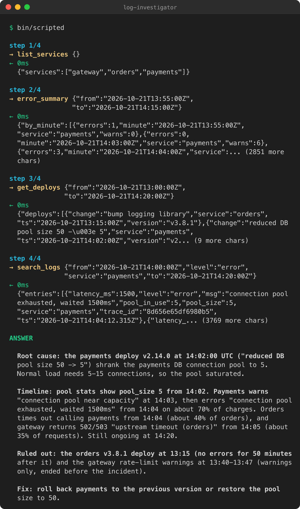
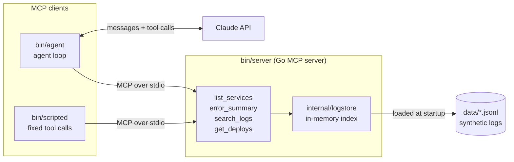

# go-mcp-demo: AI tools over MCP, written in Go

Go servers that give an AI agent tools through the
[Model Context Protocol](https://modelcontextprotocol.io) (MCP). The main example works
out the root cause of a production incident from its logs: it counts errors per minute,
finds the deploy that lined up with the spike, and reads the failing log lines. A smaller
example fetches weather forecasts and alerts. Both use the official
[Go SDK](https://github.com/modelcontextprotocol/go-sdk).



*`bin/scripted` investigating the incident: four MCP tool calls against the Go server,
then the conclusion. This client follows a fixed script, so it runs without an API key.*

## Architecture



The client starts the server as a child process and talks to it over stdin/stdout
(JSON-RPC). The server loads the logs into memory once, then answers each tool call
from that index. The weather project has the same shape, with `api.weather.gov` in place
of the log files.

## Projects

Both mini-projects are dummy projects for demonstration purposes, not production
services.

| Project | What it shows |
|---|---|
| [weather/](weather/) | A minimal MCP server and client: two tools that wrap the US National Weather Service API. |
| [log-investigator/](log-investigator/) | A larger example: an MCP server that queries synthetic incident logs, an agent that asks Claude to find the root cause, and a benchmark against an equivalent Python server. |

Requires Go 1.25.4. Each project is its own Go module, so run commands from inside its
directory.

## weather

An MCP server over stdio with two tools that call `api.weather.gov`:

| Tool | Arguments |
|---|---|
| `get_forecast` | `latitude`, `longitude` |
| `get_alerts` | `state` (two-letter US state code, e.g. `CA`) |

The client launches the server, lists its tools, and optionally calls one:

```sh
cd weather
go build -o weather ./server
go build -o weather-client ./client
./weather-client                                   # list tools
./weather-client get_alerts '{"state":"CA"}'       # call a tool
./weather-client get_forecast '{"latitude":40.71,"longitude":-74.01}'
```

## log-investigator

An MCP server exposes four read-only tools over a synthetic dataset of JSONL logs from
three services (`gateway -> orders -> payments -> DB`). The data contains one real
incident and two decoys. An agent (Claude plus an MCP client) or the no-LLM scripted
client uses the tools to work out what went wrong.

| Tool | Arguments |
|---|---|
| `list_services` | none |
| `error_summary` | `from`, `to`, optional `top_n` |
| `search_logs` | `from`, `to`, optional `service`, `level`, `text`, `limit` |
| `get_deploys` | `from`, `to` |

All data is synthetic and generated deterministically. The answer key is in
[log-investigator/data/GROUND_TRUTH.md](log-investigator/data/GROUND_TRUTH.md).

```sh
cd log-investigator
make build          # builds everything into bin/
make test           # go vet + go test
bin/scripted        # runs the server and makes four fixed tool calls, no API key needed
```

`bin/agent` needs an Anthropic API key. Copy `.env.example` to `.env` and set it there.
`.env` is gitignored. See [log-investigator/README.md](log-investigator/README.md) for
the full tool contract, the incident timeline and the project layout.

### Comparison with a Python server

`log-investigator` includes a Python MCP server
([compare/python/server.py](log-investigator/compare/python/server.py)) that implements the
same four tools on the same data. For the same inputs, both servers return the same
entries and counts. Run the comparison with `make bench`, which writes
[compare/RESULTS.md](log-investigator/compare/RESULTS.md).

Measured on one Apple M3 (24 GB RAM, macOS 26.3) with Go 1.25.4 and go-sdk v1.8.0, and
Python 3.13.3 and mcp 2.3.0. Each server ran 10 times with the first run discarded. The
table shows the median, with the range in brackets.

| Metric | Go | Python |
|---|---|---|
| Startup: spawn until `tools/list` returns (ms) | 11.8 (11.7–15.3) | 301.3 (291.7–385.3) |
| Spawn, `initialize`, `tools/list` and 20 `error_summary` calls (ms) | 28.2 (27.5–34.5) | 348.5 (337.1–439.9) |
| The 20 `error_summary` calls alone (ms) | 16.2 (15.7–19.2) | 46.0 (44.0–54.6) |
| Peak memory, RSS (MB) | 18.4 (18.0–18.6) | 72.6 (72.4–72.9) |
| On disk (MB) | 10.3 binary, 7.1 stripped (`-ldflags="-s -w"`) | 32.1 venv, plus the system Python interpreter |
| Code: non-blank, non-comment lines | 329 (128 server + 201 `internal/logstore`) | 143 |

What these numbers do and don't show:

- **Per-call differences are small.** The calls take about 0.8 ms each in Go and
  2.3 ms in Python (16 vs 46 ms across 20 calls), a gap of about 1.5 ms per call. An
  agent waits on an LLM round trip of a second or more per step, so this gap won't be
  noticeable there.
- **Startup only matters when a server is spawned per session.** That happens when it
  is launched over stdio, as in this demo. A server that stays running pays the startup
  cost once.
- **Python's startup is mostly import time for the SDK.** The benchmark runs the venv's
  `python` binary directly, with no `uv run` or other launcher. Timed separately, the
  bare interpreter starts in about 18 ms, and `import mcp.server, pydantic` takes about
  300 ms. Loading the data adds about 10 ms. This figure depends on the SDK version, not
  just the language.
- **The two servers weren't written the same way.** The Go server was written by hand,
  and the Python server was written with Claude Code to mirror it. Their outputs differ
  only in timestamp formatting: Python always includes milliseconds, which makes its
  responses 15–30% larger.
- **The test is small.** It used one machine, about 4,500 log lines and sequential calls.
  Concurrency and larger datasets were not tested. Peak memory is sampled every 20 ms.

The full methodology is in
[compare/RESULTS.md](log-investigator/compare/RESULTS.md#methodology). Results vary by
machine; run `make bench` to reproduce them.

### Tradeoffs

What was harder in Go, compared with the Python version:

- **More code.** Every tool needs a Go struct for its input and another for its output.
  The query results also have to be copied into those output structs (for example
  `toErrorSummaryOutput`). Python returns plain dicts, so the whole Python server is
  smaller than the Go query package alone.
- **More ceremony per tool.** A Go handler returns three values (a result, a typed output
  and an error), and the usual pattern of returning a `nil` result alongside the output
  isn't obvious at first. In Python, a decorated function with type hints and a
  docstring is enough.

What was harder in Python:

- **Argument names that are keywords.** `from` is a Python keyword, so the Python server
  needs a field alias and a wrapper that renames the argument before calling the tool.
  In Go it is just a struct tag, `json:"from"`.
- **Shipping it.** The Go server is a single binary. The Python server needs an
  interpreter and a virtual environment.

## How this was built

The Go MCP server, the MCP client and the agent loop were written by hand. The log
generator, log query package, terminal output, scripted client, Python comparison
server, benchmark harness and this README were built with
[Claude Code](https://claude.com/claude-code).

## License

See [LICENSE](LICENSE).
